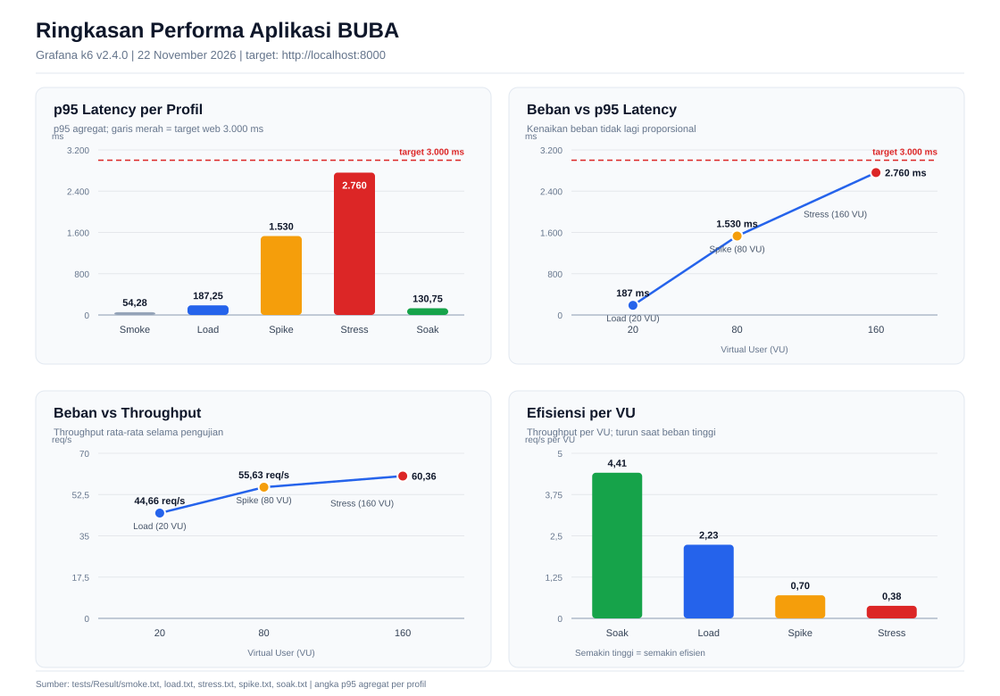

# LAPORAN PENGUJIAN PERFORMANCE

## Aplikasi BUBA (Belajar, Bermain, Berkembang)

### Tugas Non-Functional Testing — Performance Testing

| Item | Keterangan |
|---|---|
| Mata kuliah | Pengujian Perangkat Lunak |
| Topik | Non-Functional Testing — Performance Testing |
| Proyek | BUBA (Belajar, Bermain, Berkembang) |
| Teknologi aplikasi | Laravel 12.70.1, PHP 8.5.13, MySQL, REST API Sanctum |
| Tools pengujian | Grafana k6 v2.4.0 |
| Lingkungan pengujian | Lokal, `http://localhost:8000` |
| Tanggal pengujian | 22 November 2026 |
| Tanggal laporan | 23 November 2026 |
| Kelompok | ______________________________ |
| Anggota | 1. ______________________________ |
|  | 2. ______________________________ |
|  | 3. ______________________________ |
|  | 4. ______________________________ |
|  | 5. ______________________________ |

> **Ruang lingkup dokumen.** Dokumen ini membahas **Performance Testing** sebagai bagian dari tugas Non-Functional Testing. Pengujian keamanan menyeluruh (vulnerability scanning, penetration testing, OWASP ZAP, dan sejenisnya) serta pengujian usability (SUS, kuesioner, dan sejenisnya) belum tercakup dalam dokumen ini. Suite k6 memang memuat pengecekan keamanan dasar berupa akses guest dan pembatasan role, tetapi hasilnya hanya bukti tambahan dan **bukan pengganti security testing** yang lengkap.

---

## Ringkasan Eksekutif

Pengujian performance dilakukan terhadap aplikasi BUBA menggunakan lima profil Grafana k6: smoke, load, stress, spike, dan soak. Seluruh profil berhasil dijalankan pada 22 November 2026 dengan total waktu eksekusi sekitar 19 menit 13 detik. Hasil lengkap disimpan di direktori `tests/Result/`.

| Profil | Beban puncak | Durasi | Request | Throughput | Error rate | p95 | p99 | Status |
|---|---:|---:|---:|---:|---:|---:|---:|---|
| Smoke | 1 VU | 2,8 s | 91 | 31,98 req/s | 1,09%¹ | 54,28 ms | — | Lulus |
| Load | 20 VU | 2 m 3,7 s | 5.524 | 44,66 req/s | 0,00% | 187,25 ms | 242,74 ms | Lulus |
| Stress | 160 VU | 5 m 35,1 s | 20.223 | 60,36 req/s | 0,00% | 2.760 ms | 2.840 ms | Lulus² |
| Spike | 80 VU | 1 m 26,9 s | 4.837 | 55,63 req/s | 0,00% | 1.530 ms | 1.810 ms | Lulus |
| Soak | 12 VU | 10 m 4,3 s | 31.966 | 52,90 req/s | 0,00% | 130,75 ms | 167,92 ms | Lulus |

¹ Smoke: 1 dari 91 request merupakan respons 4xx yang memang disengaja oleh skenario negatif. Seluruh 111 check tetap lulus.

² Stress: threshold yang dipakai memang longgar karena tujuan stress test adalah mencari titik jenuh, bukan sekadar lulus/gagal.

**Temuan utama:**

1. **Beban normal aman.** Pada 20 VU, p95 latency web terburuk hanya 210,72 ms dan p95 API 177,44 ms. Keduanya jauh di bawah target 3.000 ms dan 1.200 ms, dengan headroom di atas 85%.
2. **Tidak ada kegagalan fungsional.** Load, stress, spike, dan soak semuanya mencatat **0% error** dan **100% check lulus**. Aplikasi tetap merespons dengan status yang benar meskipun dibebani hingga 160 VU.
3. **Terjadi saturasi latency pada beban tinggi.** Saat beban naik dari 20 VU ke 160 VU (8 kali lipat), throughput rata-rata hanya naik dari 44,66 menjadi 60,36 req/s (+35%), sedangkan p95 latency melonjak dari 187,25 ms menjadi 2.760 ms (sekitar 14,7 kali lipat). Ini indikasi kuat bahwa kapasitas server mulai jenuh, bukan aplikasi yang error.
4. **Lonjakan mendadak tertangani.** Spike 80 VU dalam 10 detik menghasilkan p95 1.530 ms tanpa error. Soak yang dijalankan setelahnya menunjukkan p95 130,75 ms, sehingga tidak ada indikasi degradasi permanen.
5. **Stabil selama 10 menit.** Soak 12 VU selama 10 menit mencatat p95 130,75 ms, p99 167,92 ms, 0 error, dan 0 iterasi terputus. Tidak terlihat penurunan performa dari sisi client.
6. **Keterbatasan utama.** Pengujian dilakukan di lingkungan lokal, tanpa metrik CPU, memori, koneksi database, dan tanpa pemisahan metrik per endpoint pada stress/spike. Oleh karena itu, penyebab pasti saturasi belum dapat dibuktikan; diperlukan pengujian lanjutan di lingkungan yang menyerupai produksi.

**Kesimpulan singkat:** Aplikasi **lulus** untuk beban normal, spike, dan soak 10 menit. Pada beban 160 VU aplikasi tetap tersedia tanpa error, tetapi p95 agregat sudah mencapai 92% dari batas 3 detik sehingga kapasitas aman berada di bawah 160 VU. Optimasi server dan database diperlukan sebelum aplikasi digunakan pada beban puncak yang lebih tinggi.



**Gambar 1.** Ringkasan p95 per profil, hubungan beban dengan latency dan throughput, serta efisiensi per VU.

---

## 1. Requirement Analysis

### 1.1 Gambaran aplikasi dan konteks pengujian

BUBA adalah aplikasi pembelajaran berbasis web yang dibangun dengan Laravel 12 dan MySQL. Aplikasi memiliki tiga kelompok pengguna utama:

- **Pengunjung publik/guest**, yang mengakses landing page, login, registrasi, halaman jam, unduhan APK, dan aset statis.
- **Siswa**, yang mengakses splash screen, daftar kelas, kategori materi, materi, kuis, hasil kuis, reward, dan profil.
- **Guru/admin**, yang mengakses dashboard, daftar kelas/kategori/materi/kuis/siswa/reward, form tambah/edit, detail data, serta unduh PDF reward.
- **Klien API (aplikasi mobile)**, yang mengakses endpoint Sanctum untuk profil, kelas, kategori, materi, kuis, dan hasil kuis.

Pola akses aplikasi didominasi operasi **read-heavy**: pengguna banyak membaca daftar materi, membuka detail, dan memuat aset halaman. Operasi tulis (login, submit kuis, logout, CRUD admin) tetap ada, tetapi tidak dijalankan pada pengujian ini agar data hasil seed tidak berubah. Pengujian difokuskan pada jalur baca yang paling sering dipakai agar hasilnya merepresentasikan beban sehari-hari.

### 1.2 Aktor dan pola akses

| Aktor | Halaman/Endpoint utama | Perilaku yang diuji | Bobot pada load test |
|---|---|---|---|
| Pengunjung publik | `/`, `/login`, `/register`, `/clock`, aset CSS/JS/gambar | Membuka halaman dan memuat aset statis | 6 VU |
| Siswa | `/siswa/welcome`, `/siswa/konten`, materi, kuis, reward, `/profile` | Menelusuri alur belajar dari splash sampai reward | 4 VU |
| Guru/admin | `/admin/dashboard`, daftar data, form tambah/edit, detail, PDF | Membuka dashboard dan halaman pengelolaan data | 2 VU |
| Klien API | `/api/me`, `/api/siswa/kelas`, kategori, materi, kuis, hasil | Membaca data JSON dengan Bearer token Sanctum | 8 VU |

### 1.3 Kebutuhan kualitas performance

Target diturunkan dari kebutuhan pengalaman pengguna dan contoh kriteria pada materi tugas: response time p95 maksimal 3 detik dan error rate maksimal 1% untuk aplikasi e-commerce. Karena BUBA adalah aplikasi pembelajaran dengan halaman web dan API JSON, target web dibuat 3 detik, sedangkan target API dibuat lebih ketat karena respons API seharusnya lebih ringan.

| ID | Kebutuhan | Metrik | Target | Alasan |
|---|---|---|---|---|
| NFR-P01 | Halaman web merespons cepat | `http_req_duration` p95 | < 3.000 ms | Batas toleransi umum agar pengguna tidak menunggu terlalu lama |
| NFR-P02 | Ekor latency web terkendali | `http_req_duration` p99 | < 6.000 ms | Melindungi pengguna dari request yang sangat lambat |
| NFR-P03 | API mobile responsif | `http_req_duration` p95 | < 1.200 ms | API JSON harus lebih cepat daripada render halaman |
| NFR-P04 | Ekor latency API terkendali | `http_req_duration` p99 | < 2.500 ms | Menjaga kualitas pengalaman pada kondisi terburuk |
| NFR-P05 | Tingkat kegagalan rendah | `http_req_failed` | < 2% | Kegagalan request harus minimal |
| NFR-P06 | Fungsionalitas tetap benar saat dibebani | `checks` | > 98% | Status, isi halaman, dan autentikasi tetap sesuai |
| NFR-P07 | Stabil dalam durasi panjang | p95/p99 soak, error rate | API p95 < 1.500 ms, API p99 < 3.000 ms, web p95 < 3.500 ms, error < 2% | Mendeteksi penurunan performa dan kebocoran memori |
| NFR-P08 | Mampu menghadapi tekanan | Error rate, checks, latency | Tidak ada 5xx, checks > 90%, failed < 10% | Mengetahui perilaku saat beban melebihi normal |
| NFR-P09 | Mampu menghadapi lonjakan | Error rate, checks, latency | checks > 95%, failed < 5%, pulih setelah lonjakan | Memastikan aplikasi tidak runtuh saat trafik naik mendadak |
| NFR-P10 | Skalabilitas terukur | Throughput vs VU | Throughput naik, titik jenuh teridentifikasi | Menjadi dasar kapasitas dan scaling |
| NFR-P11 | Observabilitas | CPU, memori, koneksi DB | Tersedia saat pengujian | Menghubungkan gejala latency dengan penyebab |
| NFR-P12 | Efisiensi transfer data | `data_received`, `data_sent` | Wajar, tidak mendominasi waktu | Memastikan bottleneck bukan jaringan |

### 1.4 Justifikasi target

- **3.000 ms p95 web** dipilih karena masih dalam batas nyaman untuk halaman yang memuat beberapa aset dan render server-side. Angka ini juga sejalan dengan contoh pada materi tugas.
- **1.200 ms p95 API** dipilih lebih ketat karena API tidak merender HTML dan seharusnya hanya mengembalikan JSON.
- **2% error rate** pada load test memberi toleransi kecil untuk gangguan jaringan lokal, tetapi hasil aktual justru 0%.
- **Soak** memakai target sedikit lebih longgar (3.500 ms p95 web) karena pengujian berjalan lebih lama dan bertujuan melihat tren, bukan hanya satu titik pengukuran.
- **Stress dan spike** memakai threshold longgar karena tujuannya adalah observasi perilaku dan pencarian batas, bukan sekadar lulus/gagal.

### 1.5 Ruang lingkup dan batasan

| Cakupan | Keterangan |
|---|---|
| Termasuk | Smoke, load, stress, spike, soak; halaman publik, siswa, admin, API baca; pengecekan keamanan dasar guest/role; aset statis |
| Tidak termasuk | Alur tulis (`write.js` tidak dijalankan), CRUD create/update/delete, submit kuis, login per VU, unduh APK pada load test, PDF reward pada load test |
| Tidak termasuk | Security testing menyeluruh (OWASP ZAP, Burp Suite, SQL injection, XSS, broken access control) |
| Tidak termasuk | Usability testing (SUS, kuesioner, think aloud, heuristic evaluation) |
| Tidak termasuk | Metrik server: CPU, RAM, disk I/O, koneksi MySQL, query time, OPcache hit rate |
| Asumsi | Database sudah di-seed, akun uji valid, aplikasi berjalan di `http://localhost:8000`, session dan cache memakai database |

---

## 2. Test Planning

### 2.1 Pemilihan tools

| Kebutuhan | Pilihan | Alasan |
|---|---|---|
| Load generator | **Grafana k6 v2.4.0** | Berbasis JavaScript, skenario fleksibel, threshold terukur, cocok untuk CI, ringan dijalankan dari CLI |
| Alternatif yang dipertimbangkan | Apache JMeter, Gatling, Locust | JMeter berat untuk skenario berbasis kode; Gatling butuh Scala/Java; Locust butuh Python dan kurang terintegrasi dengan threshold k6 |
| Runner | `tests/k6/run.sh` | Membungkus perintah k6, menetapkan `BASE_URL`, dan memudahkan pengulangan |
| Output | Ringkasan CLI dan file `.txt` | Eksekusi memakai `output: -`, sehingga tidak ada dashboard Grafana Cloud atau time-series; analisis berbasis ringkasan k6 |

Seluruh skrip pengujian berada di `tests/k6/`. Skrip memakai `setup()` untuk login sekali sebagai siswa dan admin, lalu membagikan cookie session ke seluruh VU. Pendekatan ini menghindari rate limit login (5 kali per menit per email dan IP) sekaligus mempercepat inisialisasi. Data kelas, kategori, materi, kuis, dan ID admin diambil secara dinamis melalui discovery agar pengujian tidak bergantung pada ID hardcode.

### 2.2 Lingkungan pengujian

| Komponen | Nilai |
|---|---|
| Sistem operasi | Linux |
| PHP | 8.5.13 (CLI) |
| Framework | Laravel 12.70.1 |
| Database | MySQL |
| Session driver | `database` |
| Cache store | `database` |
| Queue connection | `database` |
| Lingkungan aplikasi | `local` |
| Target | `http://localhost:8000` |
| Load generator | Grafana k6 v2.4.0 |
| Jumlah host | 1 host (aplikasi dan k6 berjalan di mesin yang sama) |
| Monitoring server | Tidak tersedia pada eksekusi ini |

> **Catatan versi.** File hasil k6 tidak mencetak versi tool secara eksplisit. Versi v2.4.0 dicatat dari lingkungan saat laporan disusun; jika eksekusi memakai versi lain, angka metrik tetap dapat dibandingkan karena format ringkasan k6 tidak berubah.

> **Catatan penting.** Target `localhost:8000` sangat mungkin dilayani oleh `php artisan serve`. Secara default server pengembangan PHP hanya memakai satu worker. Jika benar demikian, hasil stress dan spike mencerminkan **batas server pengembangan**, bukan kapasitas aplikasi di produksi. README suite k6 juga mengingatkan hal ini. Oleh karena itu, angka kapasitas pada laporan ini tidak boleh langsung dipakai sebagai kapasitas produksi.

Penggunaan `SESSION_DRIVER=database` dan `CACHE_STORE=database` juga relevan: setiap request berpotensi melakukan baca/tulis session dan cache ke MySQL. Pada beban tinggi, lalu lintas database ini dapat menjadi bottleneck tambahan.

### 2.3 Data uji dan akun

| Data | Keterangan |
|---|---|
| Akun admin/guru | `admin@example.com` / `admin123` |
| Akun siswa utama | `siswa.3206095003@example.test` / `siswa123` |
| Pool akun siswa | 8 akun kelas B dengan password `siswa123`, dipakai untuk rotasi dan menghindari rate limit |
| Data discovery | Kelas, kategori, materi, kuis, hasil kuis, ID edit admin, aset CSS/JS/gambar |
| Session | Dibuat sekali di `setup()`, dipakai bersama oleh seluruh VU |
| Token API | Dibuat sekali di `setup()`, dihapus di `teardown()` melalui `POST /api/logout` |
| Sifat pengujian | Read-only; tidak menulis data kecuali token sementara dan session |

Data seed yang dipakai relatif kecil dibanding data produksi. Hal ini perlu dicatat karena query yang cepat pada data kecil bisa melambat pada data besar, terutama pada halaman daftar admin yang mungkin memakai pagination, join, atau pencarian.

### 2.4 Model beban dan skenario

| Profil | Executor | Skenario dan VU | Tahapan | Durasi | Think time |
|---|---|---|---|---:|---|
| Smoke | `shared-iterations` | 1 VU, 1 iterasi | — | ±2,8 s | — |
| Load | `ramping-vus` | `public_browse` 6 VU, `student_web` 4 VU, `admin_web` 2 VU, `api_read` 8 VU | 30 s naik ke 40%, 60 s naik ke 100%, 30 s turun ke 0 | 2 m | Web 1–3 s; API 0,5–1,5 s |
| Stress | `ramping-vus` | `stress_web` 80 VU, `stress_api` 80 VU | 1 m ke 25%, 1 m ke 50%, 1 m ke 75%, 1 m ke 100%, 1 m bertahan 100%, 30 s turun ke 0 | 5 m 30 s | Web 0,5–1,5 s; API 0,3–1,0 s |
| Spike | `ramping-vus` | `spike_api` 60 VU, `spike_web` 20 VU | 10 s naik ke 100%, 1 m bertahan, 10 s turun ke 0 | 1 m 20 s | Web 0,5–1,5 s; API 0,3–1,0 s |
| Soak | `constant-vus` | `soak_public` 4 VU, `soak_student` 3 VU, `soak_admin` 1 VU, `soak_api` 4 VU | Konstan | 10 m | Web 1–3 s; API 0,5–1,5 s |
| Write | `per-vu-iterations` | 3 VU, 1 iterasi per VU | — | Maks 2 m | — |

Profil `write.js` tersedia di suite, tetapi **tidak dijalankan** pada pengujian ini karena menulis ke database (menambah baris `rewards` dan `personal_access_tokens`) dan sebaiknya dijalankan di staging atau database salinan. Karena itu, laporan ini belum mencakup performa alur tulis.

### 2.5 Metrik yang dikumpulkan

| Metrik | Satuan | Makna |
|---|---|---|
| `http_req_duration` | ms | Waktu request dari client sampai respons diterima |
| `http_req_failed` | % | Persentase request yang dianggap gagal (di luar 2xx/3xx) |
| `checks` | % | Persentase assertion yang lulus |
| `http_reqs` | req/s | Throughput request |
| `iteration_duration` | ms | Waktu satu iterasi lengkap, termasuk think time |
| `iterations` | iterasi/s | Jumlah iterasi skenario yang selesai |
| `vus` / `vus_max` | VU | Jumlah virtual user aktif dan maksimum |
| `data_received` / `data_sent` | MB | Volume data yang diterima dan dikirim |

Metrik yang **tidak** dikumpulkan: CPU usage, memory usage, disk I/O, jumlah koneksi MySQL, slow query, OPcache hit rate, dan metrik PHP-FPM. Ketiadaan metrik ini menjadi keterbatasan utama dalam analisis akar masalah.

### 2.6 Threshold dan kriteria keberhasilan

**Load test:**

| Metrik | Threshold |
|---|---|
| `checks` | > 98% |
| `http_req_failed` per skenario | < 2% |
| `http_req_duration{scenario:public_browse}` | p95 < 3.000 ms, p99 < 6.000 ms |
| `http_req_duration{scenario:student_web}` | p95 < 3.000 ms, p99 < 6.000 ms |
| `http_req_duration{scenario:admin_web}` | p95 < 3.000 ms, p99 < 6.000 ms |
| `http_req_duration{scenario:api_read}` | p95 < 1.200 ms, p99 < 2.500 ms |

**Soak test:**

| Metrik | Threshold |
|---|---|
| `checks` | > 98% |
| `http_req_failed` | < 2% |
| `http_req_duration{scenario:soak_api}` | p95 < 1.500 ms, p99 < 3.000 ms |
| `http_req_duration{scenario:soak_public}` | p95 < 3.500 ms |
| `http_req_duration{scenario:soak_student}` | p95 < 3.500 ms |
| `http_req_duration{scenario:soak_admin}` | p95 < 3.500 ms |

**Stress test:** `checks` > 90%, `http_req_failed` < 10%. Threshold ini longgar karena tujuannya mengamati kapan sistem mulai jenuh.

**Spike test:** `checks` > 95%, `http_req_failed` < 5%.

**Smoke test:** `checks` > 95%, `http_req_duration` p95 < 3.000 ms.

Kriteria keberhasilan keseluruhan:

1. Seluruh threshold profil yang dijalankan terpenuhi.
2. Tidak ada error 5xx atau timeout pada load, stress, spike, dan soak.
3. Performa beban normal memenuhi target p95 web dan API.
4. Stress dapat mengidentifikasi titik jenuh atau setidaknya menunjukkan tren saturasi.
5. Spike tidak menyebabkan kegagalan dan sistem kembali normal.
6. Soak tidak menunjukkan penurunan performa yang berarti.

### 2.7 Rencana urutan eksekusi

Urutan eksekusi dipilih dari yang paling ringan ke paling berat agar setiap kegagalan dasar diketahui lebih awal:

1. **Smoke** — memastikan seluruh halaman dan endpoint hidup sebelum diberi beban.
2. **Load** — membangun baseline performa pada beban normal.
3. **Stress** — menaikkan beban bertahap untuk melihat titik jenuh.
4. **Spike** — menguji lonjakan mendadak setelah sistem diketahui stabil.
5. **Soak** — menguji stabilitas jangka panjang.
6. **Write** — tidak dijalankan pada pengujian ini; direncanakan terpisah di staging.

### 2.8 Risiko dan mitigasi

| Risiko | Dampak | Mitigasi |
|---|---|---|
| Rate limit login 5 kali per menit | Setup gagal atau 429 | Login sekali di `setup()`, rotasi 8 akun siswa, `php artisan cache:clear` bila perlu |
| Session dibagi antar VU | Hasil tidak sepenuhnya merepresentasikan tiap pengguna | Catat sebagai batasan; uji login per VU melalui `write.js` di staging |
| `write.js` mengubah data | Data seed rusak | Tidak dijalankan pada pengujian ini |
| Server pengembangan 1 worker | Hasil mentok di kapasitas server, bukan aplikasi | Ulangi di PHP-FPM/nginx atau naikkan `PHP_CLI_SERVER_WORKERS` |
| Tidak ada monitoring server | Akar masalah tidak dapat dipastikan | Tambahkan Prometheus/Grafana, PHP-FPM status, dan slow query log |
| Data seed kecil | Query terlihat lebih cepat dari produksi | Uji dengan volume data mendekati produksi |
| Test berjalan berurutan | Cache/session sudah hangat saat stress | Catat sebagai ancaman validitas; ulangi dengan urutan acak atau beberapa run |
| Lingkungan lokal tanpa latency jaringan | Hasil cenderung optimistis | Uji ulang di staging dengan jaringan nyata |

---

## 3. Test Execution

### 3.1 Prosedur eksekusi

Prasyarat yang digunakan:

```bash
# 1. Siapkan database dan data seed
php artisan migrate:fresh --seed

# 2. Jalankan aplikasi
php artisan serve --host=0.0.0.0 --port=8000

# 3. Pastikan k6 tersedia
k6 version
```

Perintah pengujian yang dijalankan dari root proyek:

```bash
./tests/k6/run.sh smoke  | tee tests/Result/smoke.txt
./tests/k6/run.sh load   | tee tests/Result/load.txt
./tests/k6/run.sh stress | tee tests/Result/stress.txt
./tests/k6/run.sh spike  | tee tests/Result/spike.txt
./tests/k6/run.sh soak   | tee tests/Result/soak.txt
```

`run.sh` menambahkan header profil dan target, lalu menjalankan `k6 run` dengan `BASE_URL` yang sesuai. Eksekusi ini memakai `output: -`, sehingga ringkasan ditulis ke terminal dan disimpan sebagai file `.txt`.

### 3.2 Waktu dan durasi eksekusi

| Profil | File hasil | Perkiraan mulai | Perkiraan selesai | Durasi | Status |
|---|---|---|---:|---:|---|
| Smoke | `tests/Result/smoke.txt` | 22:16:19 | 22:16:22 | 2,8 s | Selesai |
| Load | `tests/Result/load.txt` | 22:17:23 | 22:19:27 | 2 m 3,7 s | Selesai |
| Stress | `tests/Result/stress.txt` | 22:21:12 | 22:26:47 | 5 m 35,1 s | Selesai |
| Spike | `tests/Result/spike.txt` | 22:29:51 | 22:31:18 | 1 m 26,9 s | Selesai |
| Soak | `tests/Result/soak.txt` | 22:32:31 | 22:42:35 | 10 m 4,3 s | Selesai |

Waktu di atas adalah perkiraan yang dihitung dari timestamp file hasil dan durasi yang tercatat di ringkasan k6. Semua pengujian dilakukan pada 22 November 2026, zona waktu WIB (UTC+7). Rentang dari mulai smoke sampai selesai soak sekitar 26 menit, dengan total durasi pengujian sekitar 19 menit 13 detik.

### 3.3 Hasil smoke test

| Metrik | Nilai |
|---|---|
| VU / iterasi | 1 VU / 1 iterasi |
| Total request | 91 |
| Throughput | 31,98 req/s |
| Checks | 111/111 lulus (100%) |
| `http_req_failed` | 1,09% (1 dari 91) |
| Rata-rata respons | 28,50 ms |
| Median | 18,58 ms |
| p90 | 32,06 ms |
| p95 | 54,28 ms |
| Maksimum | 283,65 ms |
| Data diterima | 16 MB |

Smoke test membuktikan seluruh halaman publik, siswa, admin, API, aset statis, PDF reward, dan endpoint kesehatan hidup. Pengecekan keamanan dasar juga lulus:

- Guest membuka `/admin/dashboard` menghasilkan `302` ke login.
- Guest memanggil `/api/me` menghasilkan `401`.
- Siswa membuka `/admin/dashboard` menghasilkan `302` ke `/siswa/welcome`.

Satu request yang tercatat gagal adalah respons 4xx yang memang disengaja oleh skenario negatif (misalnya `401` pada guest `/api/me` atau `404` pada `/download` dan `/mail/preview`). Karena seluruh check lulus, angka ini **bukan defect**. Data sebesar 16 MB berasal dari unduhan APK pada smoke test, sehingga throughput smoke tidak sebanding dengan profil lain.

### 3.4 Hasil load test

**Ringkasan keseluruhan:**

| Metrik | Nilai |
|---|---:|
| Skenario | 4 |
| Beban maksimum | 20 VU |
| Durasi | 2 m 3,7 s |
| Total request | 5.524 |
| Throughput | 44,66 req/s |
| Checks | 6.666/6.666 (100%) |
| Error rate | 0,00% (0 dari 5.524) |
| Iterasi selesai | 603 |
| Rata-rata respons | 69,95 ms |
| Median | 54,22 ms |
| p90 | 150,32 ms |
| p95 | 187,25 ms |
| p99 | 242,74 ms |
| Maksimum | 307,69 ms |
| Rata-rata durasi iterasi | 2,05 s |
| p95 durasi iterasi | 3,62 s |
| Data diterima / dikirim | 173 MB / 2,8 MB |

**Rincian per skenario:**

| Skenario | VU | Request | Gagal | Rata-rata | p95 | p99 |
|---|---:|---:|---:|---:|---:|---:|
| `public_browse` | 6 | 1.269 | 0 | 78,16 ms | 210,72 ms | 265,59 ms |
| `student_web` | 4 | 855 | 0 | 76,51 ms | 192,67 ms | 253,85 ms |
| `admin_web` | 2 | 792 | 0 | 65,86 ms | 168,55 ms | 209,34 ms |
| `api_read` | 8 | 2.584 | 0 | 65,13 ms | 177,44 ms | 233,37 ms |

Seluruh threshold load test terpenuhi. p95 tertinggi ada pada `public_browse` (210,72 ms), masih hanya 7,0% dari batas 3.000 ms. API p95 177,44 ms hanya 14,8% dari batas 1.200 ms. Dengan demikian, pada beban normal aplikasi memiliki headroom yang sangat besar.

### 3.5 Hasil stress test

| Metrik | Nilai |
|---|---:|
| Skenario | 2 (`stress_web` 80 VU, `stress_api` 80 VU) |
| Beban maksimum | 160 VU |
| Durasi | 5 m 35,1 s |
| Total request | 20.223 |
| Throughput | 60,36 req/s |
| Checks | 24.136/24.136 (100%) |
| Error rate | 0,00% (0 dari 20.223) |
| Iterasi selesai | 2.079 |
| Iterasi terputus | 3 |
| Rata-rata respons | 1.610 ms |
| Median | 1.680 ms |
| p90 | 2.710 ms |
| p95 | 2.760 ms |
| p99 | 2.840 ms |
| Maksimum | 3.420 ms |
| Rata-rata durasi iterasi | 15,49 s |
| p95 durasi iterasi | 41,08 s |
| Maksimum durasi iterasi | 50,95 s |
| Data diterima / dikirim | 551 MB / 10 MB |

Stress test tidak menghasilkan error satu pun. Aplikasi tetap mengembalikan status dan isi yang benar hingga 160 VU. Namun, latency meningkat sangat tajam: rata-rata 1.610 ms dan p95 2.760 ms, dibandingkan 69,95 ms dan 187,25 ms pada load test. p95 stress sudah mencapai **92% dari batas 3.000 ms**, sehingga margin tersisa hanya sekitar 240 ms.

Tiga iterasi terputus di akhir pengujian karena proses graceful stop ketika durasi iterasi sedang panjang (p95 41,08 detik, maksimum 50,95 detik). Iterasi yang terputus bukan error request; ini konsekuensi normal dari penghentian bertahap. Karena durasi iterasi sangat panjang, beberapa VU juga belum menyelesaikan iterasi saat tahap ramp-down berakhir.

> **Catatan keterbatasan:** ringkasan stress tidak memecah `http_req_duration` per skenario karena tidak ada threshold per skenario pada profil ini. Angka p95 2.760 ms adalah gabungan `stress_web` dan `stress_api`. Untuk mengetahui apakah API atau web yang lebih lambat, perlu threshold/tag per skenario pada pengujian berikutnya.

### 3.6 Hasil spike test

| Metrik | Nilai |
|---|---:|
| Skenario | 2 (`spike_api` 60 VU, `spike_web` 20 VU) |
| Beban maksimum | 80 VU |
| Durasi | 1 m 26,9 s |
| Total request | 4.837 |
| Throughput | 55,63 req/s |
| Checks | 5.235/5.235 (100%) |
| Error rate | 0,00% (0 dari 4.837) |
| Iterasi selesai | 541 |
| Iterasi terputus | 7 |
| Rata-rata respons | 1.180 ms |
| Median | 1.250 ms |
| p90 | 1.450 ms |
| p95 | 1.530 ms |
| p99 | 1.810 ms |
| Maksimum | 2.100 ms |
| Rata-rata durasi iterasi | 10,99 s |
| p95 durasi iterasi | 21,28 s |
| Data diterima / dikirim | 59 MB / 1,7 MB |

Spike test menaikkan beban dari 1 VU ke 80 VU dalam 10 detik, menahannya selama 1 menit, lalu menurunkannya dalam 10 detik. Aplikasi tidak menghasilkan error dan seluruh check lulus. p95 1.530 ms masih 51% dari batas 3.000 ms, sehingga lonjakan mendadak masih dapat ditangani.

Tujuh iterasi terputus di akhir karena ramp-down hanya 10 detik, sementara durasi iterasi bisa mencapai 25,41 detik. Sama seperti stress, ini bukan error; iterasi tersebut dihentikan saat VU dimatikan.

### 3.7 Hasil soak test

| Metrik | Nilai |
|---|---:|
| Skenario | 4 |
| Beban | 12 VU konstan (public 4, student 3, admin 1, API 4) |
| Durasi | 10 m 4,3 s |
| Total request | 31.966 |
| Throughput | 52,90 req/s |
| Checks | 39.383/39.383 (100%) |
| Error rate | 0,00% (0 dari 31.966) |
| Iterasi selesai | 3.545 |
| Iterasi terputus | 0 |
| Rata-rata respons | 61,43 ms |
| Median | 55,60 ms |
| p90 | 112,14 ms |
| p95 | 130,75 ms |
| p99 | 167,92 ms |
| Maksimum | 353,35 ms |
| Rata-rata durasi iterasi | 2,03 s |
| p95 durasi iterasi | 3,40 s |
| Data diterima / dikirim | 1,1 GB / 17 MB |

**Rincian per skenario:**

| Skenario | VU | Rata-rata | p90 | p95 | p99 | Maksimum |
|---|---:|---:|---:|---:|---:|---:|
| `soak_admin` | 1 | 67,01 ms | 113,39 ms | 129,83 ms | 157,63 ms | 353,35 ms |
| `soak_api` | 4 | 56,75 ms | 105,42 ms | 122,68 ms | 157,00 ms | 332,89 ms |
| `soak_public` | 4 | 63,66 ms | 120,73 ms | 141,45 ms | 183,83 ms | 342,25 ms |
| `soak_student` | 3 | 65,04 ms | 112,00 ms | 130,10 ms | 165,87 ms | 333,08 ms |

Seluruh threshold soak terpenuhi. Sebaran p95 antar skenario sangat sempit, yaitu 122,68–141,45 ms, dan tidak ada iterasi yang terputus. Tidak ada kenaikan error atau latency yang mencolok selama 10 menit. Namun, ringkasan k6 hanya memberikan agregat akhir, bukan tren per menit; oleh karena itu, klaim “tidak ada kebocoran memori” belum bisa dibuktikan tanpa metrik memori server.

### 3.8 Rekapitulasi hasil

| Profil | VU | Request | Throughput | Error | p95 | p99 | Checks | Status |
|---|---:|---:|---:|---:|---:|---:|---:|---|
| Smoke | 1 | 91 | 31,98 req/s | 1,09%¹ | 54,28 ms | — | 100% | Lulus |
| Load | 20 | 5.524 | 44,66 req/s | 0,00% | 187,25 ms | 242,74 ms | 100% | Lulus |
| Stress | 160 | 20.223 | 60,36 req/s | 0,00% | 2.760 ms | 2.840 ms | 100% | Lulus² |
| Spike | 80 | 4.837 | 55,63 req/s | 0,00% | 1.530 ms | 1.810 ms | 100% | Lulus |
| Soak | 12 | 31.966 | 52,90 req/s | 0,00% | 130,75 ms | 167,92 ms | 100% | Lulus |

¹ 4xx yang disengaja. ² Threshold longgar; lihat analisis saturasi.

---

## 4. Analysis and Evaluation

### 4.1 Perbandingan target dan hasil aktual

| Profil | Metrik | Target | Aktual | Margin | Evaluasi |
|---|---|---|---:|---:|---|
| Smoke | p95 respons | < 3.000 ms | 54,28 ms | 98,2% di bawah target | Lulus |
| Smoke | Checks | > 95% | 100% | +5 poin | Lulus |
| Load | p95 web terburuk | < 3.000 ms | 210,72 ms | 93,0% di bawah target | Lulus |
| Load | p95 API | < 1.200 ms | 177,44 ms | 85,2% di bawah target | Lulus |
| Load | p99 web terburuk | < 6.000 ms | 265,59 ms | 95,6% di bawah target | Lulus |
| Load | p99 API | < 2.500 ms | 233,37 ms | 90,7% di bawah target | Lulus |
| Load | Error rate | < 2% | 0,00% | 2 poin | Lulus |
| Load | Checks | > 98% | 100% | +2 poin | Lulus |
| Stress | p95 agregat | < 3.000 ms (acuan web) | 2.760 ms | 8,0% di bawah target | Lulus, margin tipis |
| Stress | Error rate | < 10% | 0,00% | 10 poin | Lulus |
| Stress | Checks | > 90% | 100% | +10 poin | Lulus |
| Spike | p95 agregat | < 3.000 ms (acuan web) | 1.530 ms | 49,0% di bawah target | Lulus |
| Spike | Error rate | < 5% | 0,00% | 5 poin | Lulus |
| Spike | Checks | > 95% | 100% | +5 poin | Lulus |
| Soak | p95 API | < 1.500 ms | 122,68 ms | 91,8% di bawah target | Lulus |
| Soak | p99 API | < 3.000 ms | 157,00 ms | 94,8% di bawah target | Lulus |
| Soak | p95 web terburuk | < 3.500 ms | 141,45 ms | 96,0% di bawah target | Lulus |
| Soak | Error rate | < 2% | 0,00% | 2 poin | Lulus |
| Soak | Checks | > 98% | 100% | +2 poin | Lulus |

### 4.2 Analisis load test

Pada beban normal 20 VU, aplikasi memberikan performa yang sangat baik:

- Rata-rata respons 69,95 ms dan p95 187,25 ms. Artinya, 95% request selesai di bawah 187 ms, jauh lebih cepat dari persepsi manusia terhadap waktu tunggu.
- Skenario publik memiliki p95 tertinggi (210,72 ms) karena memuat HTML dan aset statis. Perbedaan dengan skenario lain hanya sekitar 20–42 ms, jadi tidak ada endpoint yang menonjol sebagai bottleneck.
- API memiliki p95 177,44 ms, hanya 14,8% dari target 1.200 ms. Ini menunjukkan endpoint JSON cukup ringan pada beban normal.
- Tidak ada error dan seluruh 6.666 check lulus, termasuk pengecekan judul landing page, isi halaman admin, status API, dan session.
- Throughput 44,66 req/s adalah rata-rata selama 2 menit, termasuk fase ramp-up dan ramp-down. Angka ini bukan kapasitas puncak; pada fase bertahan di 20 VU, throughput aktual kemungkinan lebih tinggi.

Dengan headroom di atas 85% untuk semua target latency, beban normal 20 VU masih sangat jauh dari batas kemampuan sistem. Untuk kapasitas produksi awal, angka ini memberi keyakinan bahwa aplikasi mampu melayani puluhan pengguna bersamaan pada lingkungan yang setara.

### 4.3 Analisis stress test dan skalabilitas

Stress test memberikan gambaran yang berbeda. Beban naik bertahap sampai 160 VU, tetapi:

| Indikator | Load (20 VU) | Spike (80 VU) | Stress (160 VU) |
|---|---:|---:|---:|
| Throughput | 44,66 req/s | 55,63 req/s | 60,36 req/s |
| p95 latency | 187,25 ms | 1.530 ms | 2.760 ms |
| p99 latency | 242,74 ms | 1.810 ms | 2.840 ms |
| Rata-rata latency | 69,95 ms | 1.180 ms | 1.610 ms |
| Error rate | 0,00% | 0,00% | 0,00% |
| Throughput per VU | 2,23 req/s/VU | 0,70 req/s/VU | 0,38 req/s/VU |

**Interpretasi:**

1. **Throughput tidak naik proporsional.** Dari 20 VU ke 160 VU (8 kali lipat), throughput rata-rata hanya naik 35%, dari 44,66 menjadi 60,36 req/s. Jika sistem memiliki skalabilitas linear, kenaikan beban 8 kali seharusnya diikuti kenaikan throughput yang jauh lebih besar.
2. **Latency naik sangat tajam.** p95 naik dari 187,25 ms ke 2.760 ms, sekitar 14,7 kali lipat. Rata-rata naik dari 69,95 ms ke 1.610 ms, sekitar 23 kali lipat.
3. **Efisiensi per VU turun.** Pada load test, setiap VU menghasilkan sekitar 2,23 req/s. Pada stress, hanya 0,38 req/s per VU. Artinya, semakin banyak VU, semakin besar proporsi waktu yang dihabiskan untuk menunggu respons, bukan mengirim request baru.
4. **Tidak ada kegagalan, tetapi terjadi saturasi.** Aplikasi tidak mengembalikan 5xx dan tidak timeout. Ini berarti sistem mengalami **graceful degradation**: tetap melayani, tetapi makin lambat. Titik jenuh dalam arti kegagalan belum tercapai; yang tercapai adalah titik jenuh latency.
5. **p95 stress mendekati batas.** p95 2.760 ms adalah 92% dari 3.000 ms. Hanya tersisa sekitar 240 ms margin. Jika target API 1.200 ms diterapkan, kemungkinan besar API sudah melewati target pada beban ini, meskipun angka per skenario tidak tercatat.
6. **Iterasi menjadi sangat panjang.** p95 durasi iterasi 41,08 detik dan maksimum 50,95 detik. Satu iterasi berisi sekitar 9–10 request; jika tiap request lambat, total waktu satu iterasi melonjak. Ini juga menjelaskan mengapa beberapa iterasi terputus saat ramp-down.

**Hipotesis penyebab saturasi (perlu verifikasi):**

- **Server pengembangan satu worker.** Jika aplikasi dijalankan dengan `php artisan serve` tanpa `PHP_CLI_SERVER_WORKERS`, hanya ada satu proses PHP yang melayani request. Pada kondisi ini, penambahan VU hanya membuat antrean semakin panjang.
- **Session dan cache di database.** Dengan `SESSION_DRIVER=database` dan `CACHE_STORE=database`, setiap request dapat melakukan beberapa query tambahan ke MySQL. Pada 160 VU, query session/cache ini ikut membebani database.
- **OPcache tidak aktif pada CLI server.** `php artisan serve` memakai SAPI CLI. Jika `opcache.enable_cli` mati, kode PHP dikompilasi ulang pada setiap request, sehingga biaya CPU meningkat.
- **Query yang belum optimal.** Halaman admin yang menampilkan daftar kelas, kategori, materi, kuis, siswa, dan reward berpotensi melakukan join atau query berulang (N+1). Pada data seed yang kecil, masalah ini belum terlihat; pada data produksi, dampaknya bisa lebih besar.
- **Koneksi database terbatas.** Jika `max_connections` MySQL tercapai, request akan menunggu koneksi. Namun, karena tidak ada error, kemungkinan besar antrean terjadi di level aplikasi/server, bukan penolakan koneksi.
- **Aset statis dan payload.** Load test menerima 173 MB untuk 5.524 request (sekitar 31 KB per request). Soak menerima 1,1 GB untuk 31.966 request (sekitar 34 KB per request). Static asset caching dan kompresi dapat mengurangi beban jaringan, meskipun pada localhost jaringan bukan bottleneck utama.

Hipotesis di atas belum dapat dipastikan tanpa metrik server. Prioritas berikutnya adalah mengukur CPU, memori, query time, dan jumlah koneksi DB saat stress test berjalan.

### 4.4 Analisis spike test

Spike test menaikkan beban ke 80 VU hanya dalam 10 detik. Hasilnya:

- Tidak ada error dan seluruh 5.235 check lulus.
- p95 1.530 ms, p99 1.810 ms, maksimum 2.100 ms. Semua masih di bawah 3.000 ms.
- Throughput 55,63 req/s, lebih tinggi dari load test, tetapi lebih rendah dari stress test karena beban puncaknya lebih kecil (80 VU vs 160 VU).
- Tujuh iterasi terputus saat ramp-down 10 detik. Durasi iterasi maksimum 25,41 detik, sehingga beberapa iterasi belum selesai ketika VU dimatikan. Ini bukan kegagalan request.

Spike test menunjukkan aplikasi cukup elastis: kenaikan beban mendadak tidak menyebabkan error atau lonjakan latency yang ekstrem. p95 1.530 ms masih memberikan margin sekitar 49% terhadap target 3.000 ms.

**Pemulihan setelah spike:** pengujian soak dijalankan sekitar satu menit setelah spike selesai. Soak mencatat p95 130,75 ms dan 0 error selama 10 menit. Meskipun bukan pengukuran “sebelum-sesudah” dalam satu skenario, hasil ini memberi indikasi bahwa sistem kembali ke kondisi normal setelah lonjakan dan tidak mengalami degradasi permanen.

### 4.5 Analisis soak test

Soak test menjalankan beban sedang (12 VU) selama 10 menit. Hasilnya sangat stabil:

- p95 130,75 ms dan p99 167,92 ms, dengan sebaran antar skenario hanya 122,68–141,45 ms.
- 0 error, 100% check lulus, dan 0 iterasi terputus.
- Rata-rata 61,43 ms, bahkan lebih rendah dari load test (69,95 ms). Perbedaan ini tidak boleh langsung diartikan sebagai peningkatan performa, karena komposisi VU dan pola beban berbeda (konstan vs ramp). Namun, setidaknya tidak ada tanda penurunan performa seiring waktu.
- Throughput 52,90 req/s pada 12 VU menunjukkan sistem masih nyaman pada beban ini.

**Tentang kebocoran memori:** hasil client-side tidak menunjukkan gejala kebocoran memori, seperti kenaikan latency atau error di akhir pengujian. Namun, ringkasan k6 tidak memuat tren per menit dan tidak mengukur memori server. Oleh karena itu, klaim “bebas memory leak” belum dapat dinyatakan. Yang dapat dikatakan adalah **tidak ada indikasi degradasi performa dari sisi client selama 10 menit**.

Durasi 10 menit juga relatif singkat untuk soak test. Untuk aplikasi produksi, soak 30–60 menit atau lebih sangat disarankan, terutama untuk mendeteksi penumpukan session, file log, cache, dan koneksi database.

### 4.6 Analisis throughput, error rate, dan efisiensi

| Profil | VU | Throughput | Throughput per VU | p95 | Error | Catatan |
|---|---:|---:|---:|---:|---:|---|
| Soak | 12 | 52,90 req/s | 4,41 req/s/VU | 130,75 ms | 0,00% | Konstan, beban sedang, paling efisien |
| Load | 20 | 44,66 req/s | 2,23 req/s/VU | 187,25 ms | 0,00% | Rata-rata termasuk ramp-up/down |
| Spike | 80 | 55,63 req/s | 0,70 req/s/VU | 1.530 ms | 0,00% | Lonjakan cepat, 60 VU API |
| Stress | 160 | 60,36 req/s | 0,38 req/s/VU | 2.760 ms | 0,00% | Saturasi, efisiensi per VU terendah |

Angka throughput per VU bersifat indikatif karena komposisi skenario dan think time berbeda. Namun, polanya konsisten: semakin tinggi beban, semakin kecil kontribusi setiap VU terhadap throughput. Ini adalah ciri klasik sistem yang mendekati kapasitas.

Error rate 0% pada semua profil berbeban adalah hasil yang sangat baik. Aplikasi tidak hanya “hidup”, tetapi juga mengembalikan status, isi halaman, dan data API yang benar. Smoke test mencatat 1,09% `http_req_failed`, tetapi itu berasal dari respons 4xx yang disengaja dan seluruh check tetap lulus.

Dari sisi transfer data, soak menerima 1,1 GB dalam 10 menit (sekitar 1,9 MB/s). Pada localhost, angka ini tidak menjadi bottleneck. Di produksi, ukuran ini perlu diimbangi dengan cache header, kompresi, dan CDN untuk aset statis.

### 4.7 Temuan dan hipotesis akar masalah

| ID | Temuan | Bukti | Dampak | Hipotesis | Keyakinan |
|---|---|---|---|---|---|
| F-01 | Saturasi latency pada beban tinggi | p95 2.760 ms pada 160 VU vs 187,25 ms pada 20 VU | Pengguna menunggu lebih lama; margin target tipis | Server/DB mulai jenuh | Tinggi |
| F-02 | Throughput tidak naik proporsional | +35% throughput untuk 8x VU | Kapasitas tambahan mahal | Bottleneck di server atau database | Tinggi |
| F-03 | API berpotensi melewati target 1.200 ms saat stress | p95 agregat 2.760 ms, separuh VU adalah API | Pengalaman mobile menurun pada beban tinggi | API dan web sama-sama terdampak; perlu metrik per skenario | Sedang |
| F-04 | Iterasi terputus pada stress/spike | 3 dan 7 iterasi terputus | Tidak memengaruhi error rate, tetapi mengganggu pengukuran | Graceful stop saat iterasi panjang | Rendah |
| F-05 | Tidak ada metrik server | Hanya metrik client-side | Akar masalah tidak dapat dipastikan | Observability belum memadai | Tinggi |
| F-06 | Smoke 1,09% request failed | 1 dari 91 request 4xx | Tidak ada dampak fungsional | Respons negatif yang disengaja | Rendah |
| F-07 | Alur tulis belum diuji | `write.js` tidak dijalankan | Risiko performa CRUD belum diketahui | Dibutuhkan staging | Sedang |
| F-08 | Lingkungan uji lokal | `localhost:8000`, tanpa latency jaringan | Hasil cenderung optimistis | Perlu uji staging/produksi | Tinggi |

### 4.8 Keterbatasan dan ancaman validitas

1. **Lingkungan lokal dan satu host.** Aplikasi dan k6 berjalan di mesin yang sama. Hasil tidak memasukkan latency jaringan nyata dan dapat saling berebut CPU/RAM.
2. **Kemungkinan server pengembangan satu worker.** Jika memakai `php artisan serve` default, kapasitas yang terukur adalah kapasitas server pengembangan, bukan aplikasi di PHP-FPM/nginx.
3. **Tidak ada metrik CPU, memori, dan database.** Penyebab saturasi hanya bisa dihipotesiskan, tidak dibuktikan.
4. **Session dibagi antar VU.** Semua VU memakai session siswa/admin yang sama. Ini menghindari rate limit, tetapi tidak merepresentasikan isolasi session per pengguna dan dapat menimbulkan kontensi pada penyimpanan session.
5. **Read-only.** Alur tulis, submit kuis, dan CRUD admin tidak diuji. Beban tulis bisa berbeda jauh dari beban baca.
6. **Data seed kecil.** Volume data lebih kecil dari produksi, sehingga query daftar dan pencarian mungkin terlihat lebih cepat.
7. **Stress/spike tanpa rincian per skenario.** p95 agregat mencampur web dan API; tidak bisa memisahkan kontribusi masing-masing.
8. **Soak tanpa time-series.** Ringkasan hanya agregat akhir; tren per menit tidak tersedia.
9. **Satu kali eksekusi.** Tidak ada pengulangan untuk mengukur variansi. Hasil bisa dipengaruhi cache yang sudah hangat, urutan pengujian, atau proses lain di mesin.
10. **Tidak ada pengujian login per VU.** Rate limit dihindari dengan login sekali di setup, sehingga beban autentikasi massal belum diuji.

### 4.9 Evaluasi kelayakan

| Aspek | Status | Penjelasan |
|---|---|---|
| Beban normal (20 VU) | **Layak** | p95 187,25 ms, error 0%, headroom > 85% |
| Beban tinggi (160 VU) | **Layak dengan catatan** | Tetap 0% error, tetapi p95 2.760 ms (92% target) dan throughput tidak skalabel |
| Lonjakan (80 VU) | **Layak** | p95 1.530 ms, error 0%, pulih setelah lonjakan |
| Stabilitas 10 menit | **Layak** | p95 130,75 ms, error 0%, tidak ada degradasi client-side |
| Observabilitas | **Belum memadai** | Tidak ada metrik CPU/memori/DB |
| Alur tulis | **Belum diuji** | Perlu staging dan `write.js` |
| Keamanan menyeluruh | **Belum diuji** | Hanya pengecekan dasar guest/role |
| Usability | **Belum diuji** | Perlu SUS/kuesioner |

**Kesimpulan evaluasi:** Aplikasi BUBA **lulus** untuk beban normal, spike, dan soak 10 menit di lingkungan uji. Pada beban 160 VU, aplikasi tetap tersedia tanpa error, tetapi latency sudah mendekati batas dan throughput tidak lagi naik proporsional. Kapasitas aman berada di bawah 160 VU, dan angka pastinya perlu ditentukan melalui pengujian bertahap dengan metrik per tahap.

---

## 5. Test Report and Recommendation

### 5.1 Kesimpulan

1. Lima profil pengujian performance berhasil dijalankan: smoke, load, stress, spike, dan soak.
2. Seluruh threshold yang ditetapkan terpenuhi. Tidak ada error 5xx atau timeout pada load, stress, spike, dan soak; seluruh check mencapai 100%.
3. Pada beban normal 20 VU, performa sangat baik: p95 187,25 ms (web) dan 177,44 ms (API), jauh di bawah target.
4. Pada beban 160 VU, aplikasi tetap tersedia tanpa error, tetapi terjadi saturasi latency: p95 2.760 ms, rata-rata 1.610 ms, dan throughput hanya naik 35% dibanding 20 VU.
5. Spike 80 VU ditangani tanpa error dengan p95 1.530 ms. Soak 10 menit stabil dengan p95 130,75 ms dan 0 iterasi terputus.
6. Temuan utama bukan kegagalan fungsional, melainkan **keterbatasan skalabilitas** pada beban tinggi. Penyebab pastinya belum dapat dibuktikan karena tidak ada metrik server.
7. Aplikasi disimpulkan **lulus untuk beban normal dan pilot terbatas**, tetapi **perlu optimasi dan pengujian lanjutan** sebelum digunakan pada beban puncak yang lebih tinggi.

### 5.2 Rekomendasi perbaikan

| Prioritas | Rekomendasi | Alasan | Ukuran keberhasilan |
|---|---|---|---|
| P1 | Jalankan ulang di lingkungan menyerupai produksi: nginx/Apache + PHP-FPM, beberapa worker, OPcache aktif | Hasil saat ini kemungkinan dibatasi server pengembangan | p95 stress turun signifikan pada beban yang sama |
| P1 | Pindahkan session dan cache dari database ke Redis atau driver yang lebih cepat | `SESSION_DRIVER=database` dan `CACHE_STORE=database` menambah beban MySQL per request | Waktu respons turun, query session/cache berkurang |
| P1 | Tambahkan monitoring: CPU, RAM, disk I/O, koneksi MySQL, slow query, PHP-FPM status, OPcache hit rate | Tanpa metrik ini, akar saturasi tidak bisa dipastikan | Dashboard Grafana/Prometheus tersedia saat retest |
| P2 | Profiling endpoint lambat dengan Laravel Telescope/Debugbar dan slow query log | Menemukan query atau halaman yang paling mahal | Daftar endpoint dan query terberat terdokumentasi |
| P2 | Optimasi query: eager loading, index pada kolom filter/join, pagination, hindari N+1 | Halaman admin dan daftar materi berpotensi mahal pada data besar | Query time dan p95 halaman admin turun |
| P2 | Aktifkan cache konfigurasi, route, view, dan cache respons yang aman | Mengurangi pekerjaan berulang di setiap request | Throughput naik pada beban tinggi |
| P2 | Optimasi aset statis: cache header, kompresi, CDN | Mengurangi transfer data dan waktu muat halaman publik | `data_received` dan waktu muat turun |
| P3 | Pertimbangkan load balancer dan horizontal scaling | Meningkatkan kapasitas ketika satu instance sudah jenuh | Throughput naik mendekati linear saat VU ditambah |
| P3 | Pindahkan pekerjaan berat seperti generate PDF ke queue | Mencegah request berat memblokir request lain | PDF tidak memengaruhi p95 halaman lain |
| P3 | Tambahkan threshold dan tag per endpoint/skenario pada stress dan spike | Ringkasan saat ini mencampur web dan API | Laporan per endpoint tersedia |
| P3 | Jalankan `write.js` di staging dan uji beban tulis | Alur tulis belum tercakup | Performa CRUD dan submit kuis diketahui |
| P3 | Ulangi soak 30–60 menit dengan monitoring memori | 10 menit belum cukup untuk mendeteksi kebocoran | Tren memori dan latency stabil |

### 5.3 Rekomendasi pengujian lanjutan

| Tahap | Aktivitas | Target |
|---|---|---|
| 1 | Retest di staging dengan stack produksi | Baseline yang representatif |
| 2 | Stress bertahap 40, 80, 120, 160, 240, 320 VU; tahan 2 menit per tahap; catat p95 per tahap | Menemukan titik jenuh dan kapasitas aman |
| 3 | Spike 100 dan 200 VU; ukur 5 menit setelah lonjakan | Memastikan pemulihan |
| 4 | Soak 30–60 menit pada 12–20 VU; monitor RSS memori, koneksi DB, dan error log | Memastikan stabilitas jangka panjang |
| 5 | Uji `write.js` di staging | Mengukur performa alur tulis |
| 6 | Security testing dengan OWASP ZAP/Burp Suite | Melengkapi komponen security pada tugas |
| 7 | Usability testing dengan SUS/kuesioner | Melengkapi komponen usability pada tugas |
| 8 | Otomasi di CI dan bandingkan baseline antar rilis | Mencegah regresi performa |

Contoh perintah untuk pengujian lanjutan:

```bash
# Baseline di staging
BASE_URL=https://staging.example.test ./tests/k6/run.sh smoke

# Load lebih besar
BASE_URL=https://staging.example.test \
PUBLIC_VUS=10 STUDENT_VUS=8 ADMIN_VUS=3 API_VUS=20 \
./tests/k6/run.sh load

# Stress sampai 320 VU
BASE_URL=https://staging.example.test STRESS_PEAK=320 ./tests/k6/run.sh stress

# Spike 200 VU
BASE_URL=https://staging.example.test SPIKE_VUS=200 ./tests/k6/run.sh spike

# Soak 30 menit
BASE_URL=https://staging.example.test SOAK_DURATION=30m SOAK_VUS=12 ./tests/k6/run.sh soak

# Simpan metrik mentah dan ringkasan JSON
mkdir -p reports
./tests/k6/run.sh load --out json=reports/load.json --summary-export=reports/load-summary.json

# Dashboard web real-time
K6_WEB_DASHBOARD=true ./tests/k6/run.sh load
```

Untuk `write.js`, jalankan hanya di staging atau database salinan:

```bash
BASE_URL=https://staging.example.test WRITE_VUS=3 ./tests/k6/run.sh write
```

### 5.4 Matriks status akhir

| Komponen | Status | Catatan |
|---|---|---|
| Ketersediaan fungsional saat dibebani | **Lulus** | 0% error pada load, stress, spike, soak |
| Performa beban normal | **Lulus** | p95 187,25 ms web, 177,44 ms API |
| Ketahanan beban tinggi | **Lulus dengan catatan** | p95 2.760 ms, mendekati batas 3.000 ms |
| Ketahanan lonjakan | **Lulus** | p95 1.530 ms, 0 error |
| Stabilitas 10 menit | **Lulus** | p95 130,75 ms, 0 iterasi terputus |
| Skalabilitas | **Perlu perbaikan** | Throughput +35% untuk 8x VU |
| Observabilitas server | **Belum memadai** | Tidak ada CPU/memori/DB |
| Cakupan alur tulis | **Belum diuji** | `write.js` belum dijalankan |
| Security testing menyeluruh | **Belum diuji** | Hanya pengecekan dasar guest/role |
| Usability testing | **Belum diuji** | Perlu SUS/kuesioner |

---

## Lampiran A — Ringkasan Metrik Mentah

| Metrik | Smoke | Load | Stress | Spike | Soak |
|---|---:|---:|---:|---:|---:|
| VU maksimum | 1 | 20 | 160 | 80 | 12 |
| Durasi | 2,8 s | 2 m 3,7 s | 5 m 35,1 s | 1 m 26,9 s | 10 m 4,3 s |
| Total request | 91 | 5.524 | 20.223 | 4.837 | 31.966 |
| Throughput | 31,98 req/s | 44,66 req/s | 60,36 req/s | 55,63 req/s | 52,90 req/s |
| Total check | 111 | 6.666 | 24.136 | 5.235 | 39.383 |
| Check lulus | 100% | 100% | 100% | 100% | 100% |
| Error rate | 1,09%¹ | 0,00% | 0,00% | 0,00% | 0,00% |
| Rata-rata respons | 28,50 ms | 69,95 ms | 1.610 ms | 1.180 ms | 61,43 ms |
| Median | 18,58 ms | 54,22 ms | 1.680 ms | 1.250 ms | 55,60 ms |
| p90 | 32,06 ms | 150,32 ms | 2.710 ms | 1.450 ms | 112,14 ms |
| p95 | 54,28 ms | 187,25 ms | 2.760 ms | 1.530 ms | 130,75 ms |
| p99 | — | 242,74 ms | 2.840 ms | 1.810 ms | 167,92 ms |
| Maksimum | 283,65 ms | 307,69 ms | 3.420 ms | 2.100 ms | 353,35 ms |
| Iterasi selesai | 1 | 603 | 2.079 | 541 | 3.545 |
| Iterasi terputus | 0 | 0 | 3 | 7 | 0 |
| Data diterima | 16 MB | 173 MB | 551 MB | 59 MB | 1,1 GB |
| Data dikirim | 74 kB | 2,8 MB | 10 MB | 1,7 MB | 17 MB |

¹ 4xx yang disengaja; seluruh check lulus.

## Lampiran B — Perintah Eksekusi

```bash
# Prasyarat
php artisan migrate:fresh --seed
php artisan serve --host=0.0.0.0 --port=8000
k6 version

# Eksekusi lima profil
./tests/k6/run.sh smoke  | tee tests/Result/smoke.txt
./tests/k6/run.sh load   | tee tests/Result/load.txt
./tests/k6/run.sh stress | tee tests/Result/stress.txt
./tests/k6/run.sh spike  | tee tests/Result/spike.txt
./tests/k6/run.sh soak   | tee tests/Result/soak.txt
```

## Lampiran C — Glosarium

| Istilah | Arti |
|---|---|
| VU | Virtual User, pengguna virtual yang menjalankan skenario |
| p95 | Persentil ke-95; 95% request selesai pada atau di bawah nilai ini |
| p99 | Persentil ke-99; 99% request selesai pada atau di bawah nilai ini |
| Throughput | Jumlah request yang diproses per satuan waktu |
| Error rate | Persentase request yang gagal |
| Threshold | Batas nilai yang harus dipenuhi agar pengujian dianggap lulus |
| Ramp-up | Kenaikan beban secara bertahap |
| Ramp-down | Penurunan beban secara bertahap |
| Graceful stop | Penghentian VU secara bertahap dengan memberi waktu iterasi selesai |
| Load test | Pengujian pada beban normal yang direncanakan |
| Stress test | Pengujian dengan beban melebihi kapasitas normal untuk mencari titik jenuh |
| Spike test | Pengujian dengan lonjakan beban mendadak |
| Soak test | Pengujian beban sedang dalam durasi panjang untuk mendeteksi degradasi |
| Saturasi | Kondisi ketika penambahan beban tidak lagi menaikkan throughput secara proporsional |

## Lampiran D — Referensi

1. Grafana k6 Documentation — https://grafana.com/docs/k6/latest/
2. Laravel 12 Documentation — https://laravel.com/docs/12.x
3. Materi Pengujian Non-Fungsional, Minggu 13 — Performance Testing, Security Testing, dan Usability Testing.
4. Dokumentasi suite pengujian proyek — `tests/k6/README.md`.

## Lampiran E — File Hasil

| File | Isi |
|---|---|
| `tests/Result/smoke.txt` | Hasil smoke test |
| `tests/Result/load.txt` | Hasil load test |
| `tests/Result/stress.txt` | Hasil stress test |
| `tests/Result/spike.txt` | Hasil spike test |
| `tests/Result/soak.txt` | Hasil soak test |
| `tests/Result/LAPORAN_PERFORMANCE_TESTING.md` | Laporan ini |
| `tests/Result/laporan-performance.html` | Versi HTML siap cetak |
| `tests/Result/chart-performance.svg` | Grafik ringkasan performa |

---

> **Catatan penutup.** Laporan ini menjawab komponen **Performance Testing** pada tugas Non-Functional Testing. Untuk melengkapi tugas secara utuh, komponen **Security Testing** dan **Usability Testing** perlu disusun sebagai bagian terpisah dengan tools dan metode yang sesuai, misalnya OWASP ZAP/Burp Suite untuk keamanan dan SUS/kuesioner untuk usability.
